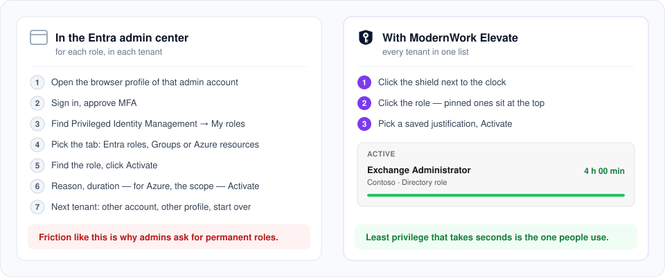
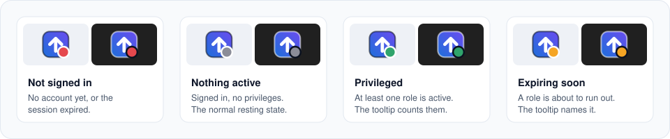
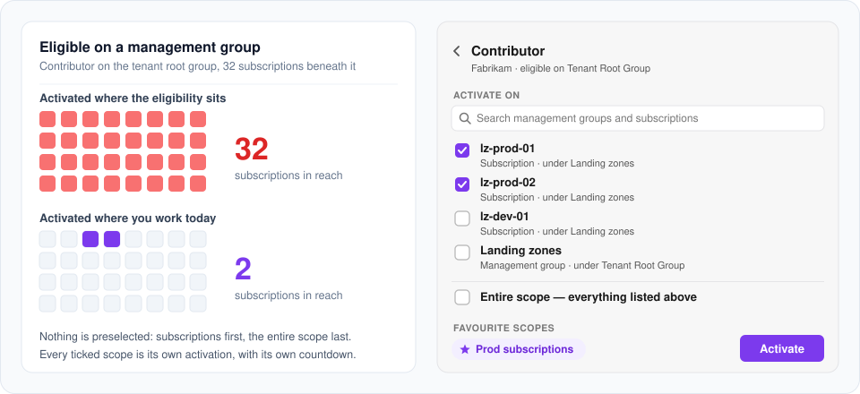

<p align="center">
  
</p>

<h1 align="center">ModernWork Elevate</h1>

<p align="center">
  <b>Just-in-time admin rights from the Windows taskbar — built for managed enterprise devices.</b><br />
  Activate Microsoft Entra roles, PIM groups and Azure resource roles from the Windows notification
  area, across every tenant you manage.
</p>

<p align="center">
  
  
  
  
  
</p>

<p align="center"><sub>A <b>mistermodernwork</b> project — tools for the modern workplace on Microsoft 365, Entra and Intune.</sub></p>

---

Privileged Identity Management only protects you if people actually use it. When activating a role
means a browser, the portal and seven clicks per tenant, admins stop activating and start asking for
permanent roles. **ModernWork Elevate** puts every role you are eligible for, in every tenant, behind an icon
next to the clock: three clicks to activate, a glance to see whether you are privileged right now,
and roles that end on their own.

ModernWork Elevate is designed for organizations that manage their devices centrally: it installs per
machine with an MSI, never updates itself, keeps no tokens on disk, signs in only through the
Windows account broker, and is configured through Group Policy or Intune.

| You want to … | Read |
| --- | --- |
| understand the security design | [docs/security-model.md](docs/security-model.md) |
| set up the App Registration | [docs/app-registration-setup.md](docs/app-registration-setup.md) |
| build, sign and roll it out (Intune / ConfigMgr / GPO) | [docs/deployment.md](docs/deployment.md) |
| write WDAC / AppLocker rules | [docs/code-signing-wdac.md](docs/code-signing-wdac.md) |
| learn the app as a user | [docs/user-guide.md](docs/user-guide.md) · [Deutsch](docs/user-guide.de.md) |
| require a fresh sign-in for every activation | [docs/fresh-sign-in.md](docs/fresh-sign-in.md) |
| report a vulnerability | [SECURITY.md](SECURITY.md) |
| contribute | [CONTRIBUTING.md](CONTRIBUTING.md) |

## Features



- **All three PIM surfaces in one list** — Entra ID directory roles, PIM for Groups (membership and
  ownership) and PIM for Azure resources, grouped per tenant, one card per tenant.
- **Many accounts, many tenants** — separate admin accounts across several tenants and both the
  Global and the Entra China (21Vianet) cloud, side by side.
- **Status at a glance** — the tray icon shows whether you are privileged right now and warns before
  a role expires; **Extend time** re-requests a running activation in one click.
- **Less typing** — pinned and recent roles, saved justifications per role, ticket fields only when
  the role's policy asks for them (ticket system prefilled per tenant), a duration slider capped by
  the role's policy.
- **Azure roles where you work** — a role held on a management group asks where to activate it,
  with nothing preselected; save sets of scopes for tomorrow.
- **No surprises** — approval, MFA and authentication-context requirements are flagged before you
  click Activate; roles reached through several paths appear once.
- **Diagnostics** — a network check that probes every endpoint the sign-in needs and copies a
  report for your network team.
- **Windows 11 native** — rounded corners and shadow from Windows, Segoe UI Variable and Fluent
  icons, your Windows accent colour, light and dark theme.





## Security

This is a privileged-access tool. The design choices are not preferences:

| Topic | Behavior |
| --- | --- |
| Sign-in | **MSAL with the Windows broker (WAM) only.** Windows Hello, passkeys, MFA and Conditional Access are handled by Windows. No password field, no reading of stored credentials, no autofill, no scripted logins. |
| Tokens | **Never written to disk.** Refresh tokens stay in the Windows token broker, access tokens in memory. |
| Device code / ROPC | **Removed.** Refused in code; keep "Allow public client flows" off so Entra refuses them too. |
| Permissions | **Delegated only**, least privilege: seven Microsoft Graph scopes plus Azure Service Management `user_impersonation`. No client secret, no application permissions. |
| Installation | Per machine in Program Files — read-only for users, fit for WDAC/AppLocker publisher and path rules. |
| User data | `%APPDATA%\ModernWorkElevate` with a user + SYSTEM-only ACL; no secrets inside. |
| Configuration | Machine policy in HKLM beats every per-user setting. |
| Network | Microsoft Entra, Microsoft Graph and Azure Resource Manager only — no telemetry, no update server, no third party. |
| Logs | No tokens, no justification text, no UPNs. |
| Supply chain | NuGet audit on; vulnerable transitive packages pinned to patched versions; build signs with your certificate. |

The app activates only what someone already made you eligible for. Maximum duration, approval, MFA
and ticket rules are enforced by Entra, not by the app.

## Requirements

- Windows 11 25H2 (build 26200) or later, x64 or ARM64
- .NET Runtime 10 or later (the Desktop Runtime is not required)
- Microsoft Entra ID P2 or Entra ID Governance in each tenant
- An App Registration owned by your organization, admin-consented in each tenant

## Quick start for administrators

**1. Create the App Registration** (once; PowerShell 7 with `Microsoft.Graph.Applications`):

```powershell
.\scripts\create-app-registration.ps1 -DisplayName "ModernWork Elevate" -SignInAudience AzureADMyOrg
```

It creates the registration with the WAM redirect URI, requests the delegated permissions, keeps
public client flows off, grants admin consent and prints the tenant and client id.
Manual steps: [docs/app-registration-setup.md](docs/app-registration-setup.md).

**2. Build and sign** (Windows, .NET SDK 10):

```powershell
pwsh -NoProfile -File .\build\build.ps1 -CertificateThumbprint <SHA1> -SignUnsignedDependencies
```

Output in `artifacts\msi`: the MSI, a detection script matching the version, a user-data clean-up
script and the policy templates.

**3. Deploy** with Intune (Win32 app, system context) or Configuration Manager:

```cmd
msiexec /i ModernWorkElevate-<version>-x64.msi /qn /norestart
```

**4. Configure centrally** — import `packaging/policy/ModernWorkElevate.admx` into Group Policy or
Intune and set the tenants:

```reg
[HKEY_LOCAL_MACHINE\SOFTWARE\Policies\ModernWorkElevate\Tenants]
"<tenant-id>"="<client-id>;Contoso;Global"

[HKEY_LOCAL_MACHINE\SOFTWARE\Policies\ModernWorkElevate]
"LockTenants"=dword:00000001
```

**5. Users** click the tray icon → **Add account** → **Sign in**, pick their admin account in the
Windows account picker, choose a role, give a reason, **Activate**.

The complete runbook — detection rules, upgrade, uninstall, footprint, troubleshooting — is in
**[docs/deployment.md](docs/deployment.md)**.

## Configuration reference

| Setting | Where | Notes |
| --- | --- | --- |
| Pre-configured tenants | `HKLM\SOFTWARE\Policies\ModernWorkElevate\Tenants\<tenant-id>` = `ClientId[;Label[;Cloud]]` | ADMX: *Pre-configured tenants and App Registrations* |
| Lock tenant list | `HKLM\SOFTWARE\Policies\ModernWorkElevate\LockTenants` = `1` | Users cannot add, change or remove tenants |
| Autostart for all users | MSI property `AUTOSTART=1` | Otherwise per-user autostart, switchable by the user |
| Per-user tenant entry | `ModernWorkElevate.exe --tenant-id … --client-id …` | For scripts in the user's context — [docs/unattended-deployment.md](docs/unattended-deployment.md) |
| Graph scopes | `appsettings.json` in the install folder | Changing them requires new admin consent |

## Building from source

```powershell
git clone https://github.com/mistermodernwork/modernwork-elevate.git
cd modernwork-elevate
dotnet build -c Release -warnaserror
dotnet test
```

Warnings are errors and StyleCop runs on every build. Core and the tests also build on Linux
(`-p:EnableWindowsTargeting=true`); the app runs on Windows only. Behind a proxy that rejects
NuGet with `407`, use `build.ps1 -NuGetSource <internal feed>` — see
[docs/deployment.md](docs/deployment.md#3-build-and-sign).

## Repository layout

```text
src/
  ModernWorkElevate.App.Avalonia   Avalonia UI, view models, tray, Windows integration
  ModernWorkElevate.Core           Auth (MSAL/WAM), Graph and ARM services, policy, models — no UI
  ModernWorkElevate.Tests          xUnit tests for Core
packaging/
  msi/                             WiX v5 per-machine installer
  policy/                          ADMX + en-US / de-DE ADML
  scripts/                         Detection, user-data clean-up, example policy
  release-notes/                   In-app "what's new" texts per version
build/                             build.ps1 (build, test, publish, sign, MSI) and sign.ps1
scripts/                           create-app-registration.ps1
docs/                              Guides, ADRs, images
```

Stack: .NET 10 · Avalonia 12 · CommunityToolkit.Mvvm · MSAL.NET + Windows broker · Microsoft Graph
SDK v5 · Azure Resource Manager REST · Serilog · xUnit + Moq · WiX v5.

## Troubleshooting

| Symptom | What to do |
| --- | --- |
| Consent dialog when signing in | A requested permission is not admin-consented in that tenant — compare with [the list](docs/app-registration-setup.md#3-api-permissions-delegated). A broader permission does not satisfy a request for a narrower one. |
| "Couldn't load eligibilities for this tenant" | Check `%LOCALAPPDATA%\ModernWorkElevate\logs`; its first line names the running version. |
| "Azure resource roles unavailable" | Directory roles loaded, Azure Resource Manager did not. The text names the cause — most often a proxy or firewall blocking the Azure Resource Manager endpoint (**Network check** shows it) or missing Azure Service Management consent. The app retries on its own and after the network comes back. |
| Blank sign-in window | A blocked Microsoft endpoint — run **Settings → Diagnostics → Network check** and send the report to the network team. |
| App exits at start | Windows older than 25H2 (exit code `3`). |
| Build fails with `NU1301 … 407` | Proxy authentication for NuGet — use an internal feed or restore once outside the proxy. |

More in the [user guide](docs/user-guide.md#when-something-does-not-work) and the
[deployment guide](docs/deployment.md#11-troubleshooting).

## Contributing and license

Contributions are welcome — see [CONTRIBUTING.md](CONTRIBUTING.md). Changes are listed in
[CHANGELOG.md](CHANGELOG.md). Released under the [MIT License](LICENSE).

Microsoft, Entra, Azure, Intune and Windows are trademarks of the Microsoft group of companies.
ModernWork Elevate is an independent project and not affiliated with or endorsed by Microsoft.
